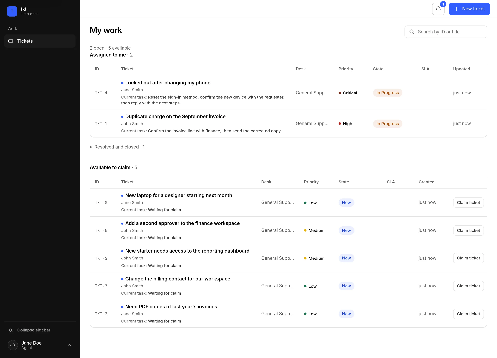

<div align="center">

<picture>
  <source media="(prefers-color-scheme: dark)" srcset="docs/images/banner-dark.svg">
  
</picture>

# tkt

Una plataforma de gestión de help desk autoalojada.

[English](README.md) | **Español**

[](https://github.com/giulianotesta7/tkt/actions/workflows/quality.yml)
[](https://github.com/giulianotesta7/tkt/actions/workflows/e2e.yml)
[](https://github.com/giulianotesta7/tkt/actions/workflows/container.yml)
[](https://github.com/giulianotesta7/tkt/actions/workflows/security.yml)

</div>

Una cola de tickets compartida en un solo binario de Go, con SQLite integrado y HTML
renderizado en el servidor con HTMX. No requiere base de datos externa, caché, broker de
mensajes ni framework de JavaScript. Un solo volumen de datos guarda todo, y actualizar
es reemplazar la imagen.

<div align="center">

<picture>
  <source media="(prefers-color-scheme: dark)" srcset="docs/images/my-work-dark.webp">
  
</picture>

</div>

## Rendimiento medido

| Medición | Resultado |
| --- | --- |
| Imagen sin comprimir | 31,4 MB |
| Mediana de arranque, base nueva / existente | 0,54 / 0,41 s |
| Memoria del contenedor, reposo tras lecturas / máximo muestreado bajo carga | 172,4 / 180,3 MiB |
| Mediana HTTP de la cola del agente, concurrencia 1 / 5 | 6,1 / 21,3 ms |
| Mediana del marcador de cola visible en navegador, caché fría / caliente | 120 / 124 ms |

Mediciones locales, no garantías de rendimiento.

## Capacidades

- **Flujos por categoría.** Cada categoría ejecuta los pasos que diseñes: formularios de
  solicitante y de agente, tareas manuales, asignación a una mesa, resolución y cierre, con
  traza de auditoría.
- **Roles y mesas.** Cuatro roles (Usuario, Agente, Administrador, Root); la membresía de mesa
  decide quién trabaja cada cola.
- **SLA sobre el horario laboral.** Objetivos por categoría en horas y días laborables; la
  espera, la pausa y la reanudación mueven el compromiso.
- **Notificaciones.** Campana en la aplicación para todos, más emails opcionales por tu propio
  servidor SMTP.
- **Búsqueda, filtros, exportación CSV y adjuntos** para trabajar una cola y dejar la evidencia
  en el ticket.
- **Contraseñas de autoservicio.** Cada persona cambia su propia contraseña y, con los emails
  configurados, la recupera desde la página de inicio de sesión.
- **Sugerencias de categoría.** Un motor local de palabras clave propone categorías a partir de
  la descripción, o un endpoint de modelo de decisión si lo configurás.
- **Interfaz en inglés y en español**, el nombre y el logo de tu organización, y un solo idioma
  de interfaz para toda la instancia.

## Inicio rápido

### Docker Compose (recomendado)

```console
git clone https://github.com/giulianotesta7/tkt.git
cd tkt
docker compose up -d --build
```

Compose compila la imagen desde este checkout.

### Compilar desde el código fuente

```console
git clone https://github.com/giulianotesta7/tkt.git
cd tkt
mkdir -p data bin
CGO_ENABLED=0 go build -o bin/tkt ./cmd/server
TKT_LISTEN=127.0.0.1:8080 TKT_DB_PATH=data/tkt.db ./bin/tkt
```

El servidor corre en primer plano en esa terminal.

### Primer inicio

Creá la primera cuenta en `http://localhost:8080/setup`, que pasa a ser root, y publicá el flujo
de una categoría para que la cola reciba su primer ticket.
[Primeros pasos](docs-es/getting-started.md) tiene los detalles.

## Documentación

| Guía | Qué cubre |
| --- | --- |
| [Instalar y configurar tkt](docs-es/getting-started.md) | Cuenta root, configuración mínima |
| [Desplegar tkt](docs-es/deployment.md) | Imagen, volumen de datos, URL base pública, proxy HTTPS, configuración |
| [Administrar tkt](docs-es/administration.md) | Usuarios y roles, mesas, catálogo, flujos, SLA, emails, Seguridad |
| [Referencia de la API v1](docs-es/api.md) | Autenticación Bearer, alcances, endpoints JSON, errores, ejemplos con curl |
| [Trabajar un ticket](docs-es/user-guide.md) | Recorridos del solicitante y del agente: crear, responder, esperar, cerrar |
| [Backupear y actualizar](docs-es/backup-and-upgrade.md) | Qué backupear, restaurar, actualizar |
| [Contribuir](CONTRIBUTING.md) | Desarrollo local, capas de tests, cómo contribuir |

## Contribuir

Los issues y los pull requests son bienvenidos. Ver [CONTRIBUTING.md](CONTRIBUTING.md).

## Licencia

tkt está bajo la licencia Apache License 2.0. Ver [LICENSE](LICENSE).

La fuente Inter incluida es software de terceros bajo la SIL Open Font License 1.1. Ver
[su licencia](web/templates/static/InterVariable-LICENSE.txt).
