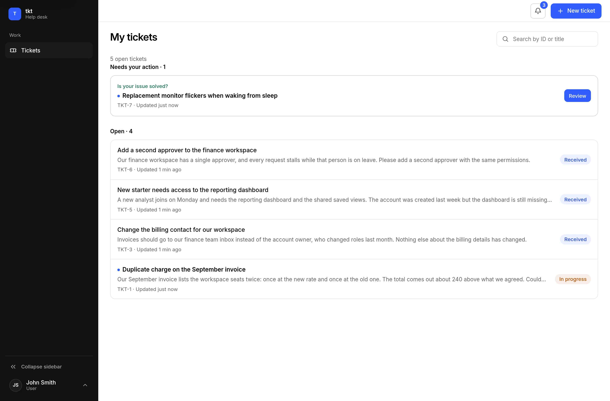
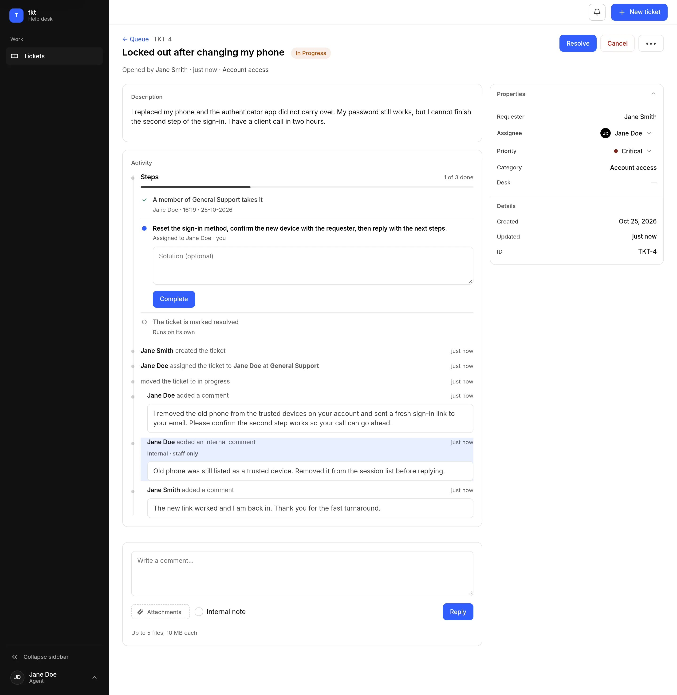

# User guide

**English** | [Español](../docs-es/user-guide.md)

A ticket has two sides: the person who reports a problem and the team that works on it. What
each role may do is in [Administration](administration.md#roles).

## Reporting a problem

### Find your tickets

**Tickets** opens **My tickets**, grouped by what each request needs from you:

- **Needs your action**: tickets on hold waiting for your reply, and resolved tickets waiting
  for your confirmation.
- **Open**: requests still being worked on.
- **Closed**: folded at the end.

A dot next to a title means something changed since you last opened that ticket.

<picture>
  <source media="(prefers-color-scheme: dark)" srcset="images/my-tickets-dark.webp">
  
</picture>

### Create a ticket

**New ticket** asks for a title and a description, plus:

- **Category**: where the request belongs. Depending on the instance, you pick it on the same
  page or after choosing from the catalog.
- **Priority**: low, medium, high, or critical. It drives queue order.
- **Attachments**: up to 5 files of 10 MB each. A file must really be the type its name claims;
  a text file renamed to `.png` is refused.

Category suggestions, when the instance offers them, are a hint: up to three, never applied for
you, and the catalog stays available.

A category appears in the picker only after its workflow is published, so an empty picker means
no category is published yet.

### Reply, hold and confirm

- While the ticket is open, write in the composer and choose **Reply**. Your reply is public and
  the team is notified.
- If the team puts the ticket **On hold**, the ticket shows what they need from you. Your reply
  ends the hold.
- When the team marks the ticket **Resolved**, the ticket asks **Is your issue solved?**. Choose
  **Yes, close ticket**, or **No, I still need help** to send it back. A rejected resolution
  reopens the ticket as a manual ticket, so a workflow cannot close it behind your back.
- Resolved and closed tickets have no reply box.

Your list uses the labels **Received**, **In progress**, **Resolved**, **Closed**, and
**Cancelled**.

## Working on tickets

### Your queue

**My work** lists what you can act on:

- **Assigned to me**
- **Available to claim**: tickets waiting on a desk you belong to, when the workflow uses
  **Claim**. Choose **Claim ticket** to take one.
- **Resolved and closed**

A **Least loaded** workflow assigns the ticket to an available member of the desk, so it never
waits in the claimable list.

### Work a ticket

<picture>
  <source media="(prefers-color-scheme: dark)" srcset="images/ticket-detail-dark.webp">
  
</picture>

- **State** moves through **Start**, **Resolve**, **Cancel**, and **Reopen**, offering only the
  actions legal for that ticket.
- **Reply** is public: the requester reads it and is notified. **Internal note** is staff-only
  and never shown to the requester, including its attachments.
- **Attachments** follow the comment they belong to: a file on an internal note is staff-only,
  any other file is visible to whoever can open the ticket.
- **Properties** changes the priority and reassigns the ticket when you have permission.
  Reassigning to another person requires a reason; claiming an unassigned ticket does not.

### Hold, resolve and close

- **Put on hold** parks a ticket that waits on the requester. They see the reason you write, the
  resolution clock pauses, and the first-response clock keeps running. **Resume** ends the hold,
  and so does a public reply from the requester.
- **Resolve** asks the requester to confirm, as described above.
- A ticket with a requester cannot be closed by hand from the resolved state: only the
  requester's confirmation or a workflow step that closes it ends the ticket. Cancelling ends a
  ticket nobody will work on, and it cannot be reopened.
- Reopening a closed ticket requires a reason and returns it to **In progress**.

### Workflow steps

A published workflow drives the ticket, and its steps are described in
[Administration](administration.md#workflows).

## Notifications and preferences

The bell collects what happened on tickets you can see: assignments, new comments, state
changes, SLA warnings, holds, and resolution answers.

**Preferences** holds your ticket list order, the light, dark, or system theme, whether you also
get notifications by email (on by default, useful only when the instance has email), and your
own password when the instance allows it.

Changing your password signs out every other session; the one you change it from stays open.

## If you forget your password

With email configured and the feature enabled, the sign-in page carries **Forgot your
password?**. Enter your address and tkt sends a single-use link that expires after one hour. The
answer is the same whether or not the address has an account.

The link lets you choose a new password, signs the account out everywhere, and asks you to sign
in again. If two requests are sent for the same account at almost the same moment, both messages
may arrive and only the latest link works; the details are in
[Administration → Security](administration.md#security).

> [!NOTE]
> If no message arrives, the instance either does not offer recovery or has no working mail
> server.
